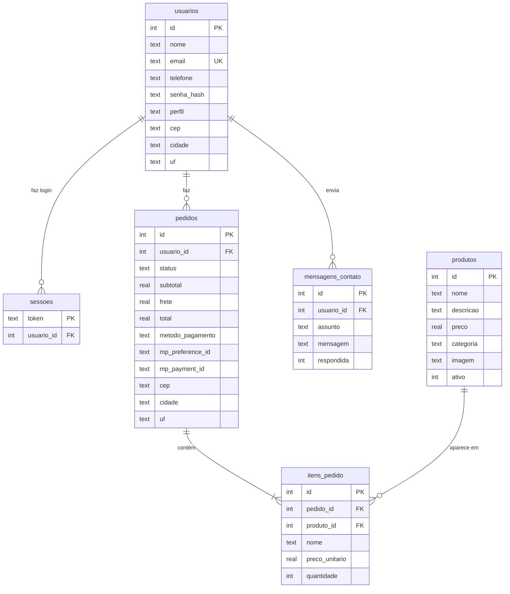

# 🧁 Doce Encanto

Aplicativo de e-commerce da confeitaria **Doce Encanto**, desenvolvido em **React Native (Expo)** para o
Projeto Integrador IV – Desenvolvimento para Dispositivos Móveis (Senac).

A cliente navega pelo cardápio, monta o carrinho, informa o CEP (endereço preenchido pelos Correios/ViaCEP),
paga pelo **Mercado Pago** e acompanha o pedido. A administradora cadastra, altera e exclui produtos,
acompanha os pedidos, responde mensagens e **exporta os dados em JSON** para o dashboard em Python.

| Parte | Tecnologia | Pasta |
|---|---|---|
| App móvel | React Native + Expo SDK 57 + Expo Router + TypeScript | `src/` |
| API REST (backend) | Node.js + Express 5 | `server/` |
| Banco de dados | SQLite (embutido no Node.js, `node:sqlite`) | `server/src/schema.sql` |
| Pagamento | API do Mercado Pago (Checkout Pro) | `server/src/mercadopago.js` |
| CEP | API ViaCEP (Correios) | `src/services/viacep.ts` |
| Dashboard | Python + Streamlit + Plotly + Pandas | `dashboard/` |
| Testes | Jest, Testing Library, Supertest, Playwright, Maestro | `__tests__/`, `server/tests/`, `e2e/` |

---

## Como rodar

Pré-requisitos: **Node.js 22.13 ou mais novo (recomendado: 24 LTS)**, o app **Expo Go** no celular (ou um emulador) e, para o dashboard,
**Python 3.10+**.

### 1. API (backend)

```bash
cd server
npm install
npm start
```

O terminal mostra o endereço da API (porta **3333**) e se o Mercado Pago está ativo ou em modo demonstração.
Na primeira execução o banco `server/data/doceencanto.db` é criado com o cardápio e dois usuários:

| Perfil | E-mail | Senha |
|---|---|---|
| Administradora | `admin@doceencanto.com` | `admin123` |
| Cliente | `maria@exemplo.com` | `123456` |

Opcional, para o dashboard ter volume: `npm run seed:demo` cria 40 clientes e 180 pedidos **fictícios** dos
últimos 4 meses (use só para demonstração).

### 2. App

Em outro terminal, na raiz do projeto:

```bash
npm install
npx expo start
```

Leia o QR code com o Expo Go. **O celular e o computador precisam estar na mesma rede Wi-Fi.** O app descobre
sozinho o IP do computador. Se não conectar (rede da faculdade costuma bloquear), crie um arquivo `.env` na raiz:

```
EXPO_PUBLIC_API_URL=http://SEU_IP:3333
```

Também funciona no navegador: `npx expo start --web`.

### 3. Mercado Pago (opcional)

Sem configuração nenhuma, o app roda em **modo demonstração**: depois de finalizar a compra aparece o botão
"Simular pagamento aprovado". Para usar o checkout real em modo de teste:

1. Crie uma aplicação em <https://www.mercadopago.com.br/developers/panel/app> e copie o **Access Token de teste**.
2. Copie `server/.env.example` para `server/.env` e preencha `MP_ACCESS_TOKEN=...`.
3. Reinicie a API. Agora "Pagar" abre o checkout do Mercado Pago (Pix, cartão ou boleto). Use os
   [cartões de teste](https://www.mercadopago.com.br/developers/pt/docs/checkout-pro/additional-content/your-integrations/test/cards)
   e um comprador de teste.
4. Ao voltar para o app, a tela do pedido consulta a API, que consulta o Mercado Pago e atualiza o status
   (sincronização). Com um endereço público https (ex.: `ngrok http 3333`) em `PUBLIC_URL`, o Mercado Pago
   também avisa a API sozinho pelo webhook.

O token fica **só no servidor**; o app nunca recebe dados de cartão.

### 4. Dashboard (Análise de Dados e Estatística)

1. No app, entre como administradora → **Conta → Exportar dados (JSON)** e salve o arquivo.
2. Rode:

```bash
cd dashboard
pip install -r requirements.txt
streamlit run dashboard.py
```

3. Envie o JSON pela barra lateral. Sem arquivo, ele abre o exemplo em `dashboard/dados/` (dados fictícios).

O dashboard mostra faturamento, ticket médio, evolução semanal, produtos e categorias mais vendidos, dias e
horários de pico, formas de pagamento, situação dos pedidos, vendas por estado e a **estatística descritiva**
do valor dos pedidos (média, mediana, moda, desvio-padrão, quartis e histograma).

---

## Testes

| Tipo | O que cobre | Como rodar |
|---|---|---|
| Unitários (app) | formatação de preço/CEP/telefone, regras do carrinho, ViaCEP, cliente da API | `npm test` |
| Integração (app) | tela de Login + AuthContext + API; tela do Carrinho + CartContext; modal do app (avisos, confirmações e fila) | `npm test` |
| Unitários (API) | frete, senhas, validações, integração com o Mercado Pago (simulada) | `cd server && npm test` |
| Integração (API) | todas as rotas com banco SQLite em memória: cadastro, login, CRUD de produtos, pedidos, pagamento, contato, exportação | `cd server && npm test` |
| E2E web | fluxo completo no navegador (compra da cliente + CRUD da admin + exportação) com Playwright, gera as capturas de tela | `python e2e/web/fluxo_completo.py` |
| E2E mobile | fluxos no celular/emulador com Maestro | `maestro test e2e/maestro` |

Resultado atual: **46 testes no app e 39 na API passando**; o fluxo E2E web passa do login ao relatório sem erros
no console. Cobertura: `npm run test:cobertura`.

---

## Telas (12)

| Tela | Arquivo | Quem usa |
|---|---|---|
| Login | `src/app/login.tsx` | todos |
| Cadastro (com CEP automático) | `src/app/cadastro.tsx` | cliente |
| Cardápio (busca e categorias) | `src/app/(loja)/catalogo.tsx` | cliente |
| Detalhe do produto | `src/app/produto/[id].tsx` | cliente |
| Carrinho | `src/app/(loja)/carrinho.tsx` | cliente |
| Finalizar compra (endereço, frete, Mercado Pago) | `src/app/pagamento.tsx` | cliente |
| Pedido (status, pagamento, sincronização) | `src/app/pedido/[id].tsx` | cliente e admin |
| Meus pedidos | `src/app/(loja)/pedidos.tsx` | cliente |
| Fale conosco (contato do cliente) | `src/app/(loja)/contato.tsx` | cliente |
| Minha conta / Meus dados | `src/app/(loja)/perfil.tsx`, `src/app/editar-perfil.tsx` | todos |
| Gerenciar produtos + formulário (CRUD) | `src/app/admin/produtos.tsx`, `src/app/admin/produto-form.tsx` | admin |
| Todos os pedidos / Mensagens | `src/app/admin/pedidos.tsx`, `src/app/admin/mensagens.tsx` | admin |

Capturas de tela: `e2e/web/capturas/` (geradas pelo teste E2E) e `dashboard/capturas/`.

---

## Banco de dados



Script completo: `server/src/schema.sql`. As fotos do cardápio ficam em `server/public/produtos/` e são servidas pela API em `/imagens/produtos/...`; fotos enviadas pela administradora no app são guardadas no banco. Senhas são guardadas com hash (scrypt + sal).
O preço do pedido é sempre recalculado no servidor a partir do banco. Produto que já foi vendido não é
apagado, só sai do cardápio (para não perder o histórico de vendas).

## API REST

| Método | Rota | Descrição | Acesso |
|---|---|---|---|
| POST | `/auth/cadastro` | Cria conta de cliente | público |
| POST | `/auth/login` · `/auth/logout` | Entra / sai | público / logado |
| GET · PUT | `/auth/me` | Consulta / altera o próprio cadastro | logado |
| GET | `/produtos?categoria=&busca=` | Lista o cardápio | público |
| GET | `/produtos/:id` | Um produto | público |
| POST · PUT · DELETE | `/produtos` · `/produtos/:id` | Cria / altera / exclui produto | admin |
| GET | `/frete?uf=&subtotal=` | Calcula o frete | público |
| POST | `/pedidos` | Finaliza a compra e gera o checkout do Mercado Pago | logado |
| GET | `/pedidos` · `/pedidos/:id` | Lista / detalha pedidos (admin vê todos) | logado |
| POST | `/pedidos/:id/sincronizar` | Consulta o pagamento no Mercado Pago e atualiza o pedido | dono ou admin |
| POST | `/pedidos/:id/pagar` · `/cancelar` | Novo link de pagamento / cancelar | dono |
| POST | `/pedidos/:id/simular-pagamento` | Só no modo demonstração | dono |
| PATCH | `/pedidos/:id/status` | Muda o andamento (em preparo, enviado...) | admin |
| POST · GET | `/contato` | Envia / lista mensagens | logado |
| PATCH · DELETE | `/contato/:id` | Marca respondida / exclui | admin |
| GET | `/relatorios/export` | JSON para o dashboard (sem dados pessoais) | admin |
| POST | `/pagamentos/webhook` | Notificações do Mercado Pago | Mercado Pago |

## Recursos de experiência

- **Modal próprio** (`src/components/Modal.tsx`): avisos de sucesso, erro, aviso e informação, e confirmações (sair, excluir, cancelar pedido). Aparece no login, cadastro, ao adicionar ao carrinho, no pagamento aprovado/recusado, ao salvar dados e produtos.
- **Favoritos**: coração no card e no detalhe do produto, filtro "Favoritos" no cardápio (guardado no aparelho, por cliente).
- **Ordenação do cardápio**: destaques, menor preço, maior preço e A–Z.
- **Linha do tempo do pedido**: pedido feito → pagamento aprovado → em preparo → saiu para entrega → entregue.

## Ícones

O app usa os ícones Material Design (mesma família do kit Material 3 do Figma) pelo componente `src/components/Icone.tsx`. Para trocar um ícone, procure o nome em <https://pictogrammers.com/library/mdi/>.

## Estrutura de pastas

```
src/
  app/            telas (cada arquivo é uma rota do Expo Router)
  components/     botões, campos, formulário de endereço, listas
  contexts/       AuthContext (login) e CartContext (carrinho)
  services/       cliente da API, ViaCEP, exportação JSON, tipos
  utils/          formatação, regras do carrinho, diálogos
  constants/      cores e medidas (identidade visual)
server/           API REST + banco SQLite + Mercado Pago
dashboard/        dashboard em Python
__tests__/        testes do app (unidade e integração)
e2e/              testes ponta a ponta (Playwright web e Maestro mobile)
```
